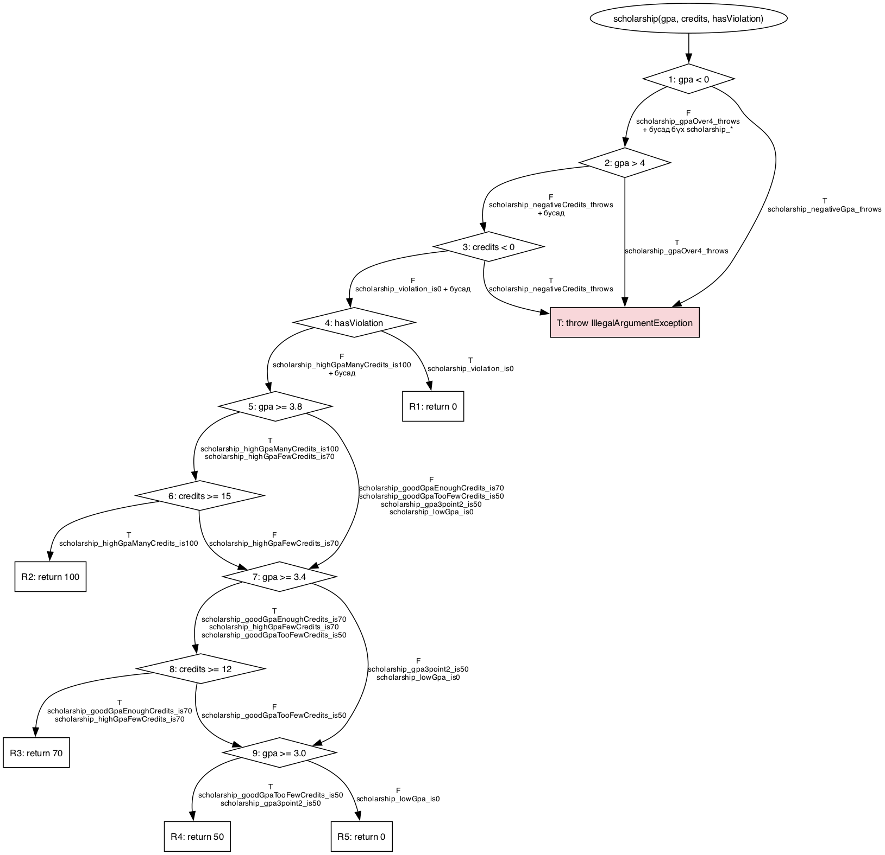

# Лаборатори №9: Код хамралт — JaCoCo

**F.CSA313 — Программ хангамжийн чанарын баталгаа ба тест (2026)**

- **Оюутны нэр:** Б.Билгүүнтөр
- **Оюутны код:** B242270505

```
$ java -version
openjdk version "26.0.1" 2026-04-21
OpenJDK Runtime Environment (build 26.0.1+8-34)
OpenJDK 64-Bit Server VM (build 26.0.1+8-34, mixed mode, sharing)

$ mvn -version
Apache Maven 3.10.1 (3afd8084b5629f80b97750906a719879ed4cd283)
Maven home: /opt/homebrew/Cellar/maven/3.10.1/libexec
Java version: 27.0.1.1, vendor: Homebrew, runtime: /opt/homebrew/Cellar/openjdk/27.0.1.1/libexec/openjdk.jdk/Contents/Home
Default locale: en_MN, platform encoding: UTF-8, time zone: Asia/Ulaanbaatar
OS name: "mac os x", version: "26.6.2", arch: "aarch64", family: "mac"
```

Starter: Teams Lab09-ийн `starter.zip` (`pom.xml` + `ScholarshipCalculator.java`). Тестүүд: [ScholarshipCalculatorTest.java](src/test/java/mn/edu/must/sqat/ScholarshipCalculatorTest.java).

## Хэсэг A: happy path, эхний хэмжилт

5 тест ([mvn-verify-A.txt](results/mvn-verify-A.txt): `Tests run: 5`). [jacoco-A.csv](results/jacoco-A.csv)-ээс:

| | Covered | Missed | % |
|---|---|---|---|
| Line | 15 | 10 | **15/25 = 60%** |
| Branch | 20 | 21 | **20/41 = 48.8%** |

**Шар/улаан мөрүүд** (JaCoCo-ийн мөрийн өгөгдлөөс):
- **Шар** (салааны зарим нь л хамрагдсан):
  - бүх "буруу оролт" шалгалт: `score < 0 || score > 100`, `scores == null || length == 0`, `gpa < 0 || gpa > 4 || credits < 0`. Зөвхөн F салаа нь дайрагдсан;
  - `switch (letterGrade(s))`: 3 салаа дутуу;
  - `gpa >= 3.8 && credits >= 15`: "голч хангасан ч кредит дутуу" салаа дутуу.
- **Улаан** (огт хүрээгүй):
  - бүх `throw` мөр;
  - `letterGrade`-ийн C/D/F;
  - `gpa`-ийн `case "C"`, `case "D"`;
  - `scholarship`-ийн `return 50` болон сүүлийн `return 0`.

Өөрөөр хэлбэл happy path нь алдааны замуудыг ба доод ангиллын дүнгүүдийг огт хамардаггүй.

## Хэсэг B: CFG ба 100%



`scholarship()`-ийн CFG-г [cfg.png](cfg.png)-д үзүүлэв. 9 шийдвэрийн зангилаа, throw ба 5 return бий. Ирмэг бүр дээр түүнийг дайрдаг тестийн бодит метод нэрийг бичсэн. Зургийг гараар биш, Graphviz-ээр ([docs/cfg.dot](docs/cfg.dot)) зурсан. Ирмэг дээрх нэр бүр тест файлд байгааг скриптээр тулгаж шалгасан.

Нэмсэн тестүүд:
- `letterGrade`: C, D, F болон `-1`/`101` exception;
- `gpa`: C/D/F холимог (switch-ийн `default` салаа), `null`, хоосон массив;
- `scholarship`: `||` нөхцөл бүрд тусдаа `assertThrows` (`gpa<0`, `gpa>4`, `credits<0`), зөрчилтэй, "голч ≥3.8 ч кредит <15", "голч ≥3.4 ч кредит <12", 3.2 → 50, 2.0 → 0.

**Шаардагдсан тестийн тоо: 21** ([mvn-verify-B.txt](results/mvn-verify-B.txt): `Tests run: 21, Failures: 0`). [jacoco-B.csv](results/jacoco-B.csv): **BRANCH_MISSED = 0** (41/41), **LINE_MISSED = 0** (25/25), Line ба Branch хоёулаа 100%.

## Хэсэг C: давталтын зааг (0 / 1 / 2+)

| Тест | Шалгах зүйл |
|---|---|
| `gpa_loopZeroTimes_emptyAndNullThrow` | хоосон массив болон `null` → `assertThrows(IllegalArgumentException)` |
| `gpa_loopOnce_singleScore95_is4` | `gpa([95]) == 4.0` |
| `gpa_loopManyTimes_fourScores_is2point5` | `gpa([95,85,75,65]) == 2.5` |

Эдгээр тест хамралтыг өсгөөгүй, учир нь хамралт аль хэдийн 100% байсан (24 тест). Гэхдээ хамралт нь "давталтын бие дор хаяж нэг удаа гүйцэтгэгдсэн"-ийг л хэмждэг, хэдэн удаа гүйснийг хэмждэггүй. Давталтын хамгийн түгээмэл алдаанууд (нэгээр зөрөх, хуримтлуурыг дахин эхлүүлэхгүй байх, нэг элементтэй үед хуваах) зөвхөн 0/1/олон удаагийн тодорхой тохиолдолд л илэрнэ.

## Хэсэг D: хамралт 100%, гэхдээ алдаа амьд

7 зааг утгатай `@ParameterizedTest` нэмсэн: `letterGrade_boundaryValues_matchSpec`. [mvn-test-D-fail.txt](results/mvn-test-D-fail.txt):

```
[ERROR] mn.edu.must.sqat.ScholarshipCalculatorTest.letterGrade_boundaryValues_matchSpec(double, String)[1] -- ... <<< FAILURE!
[ERROR]   ScholarshipCalculatorTest.letterGrade_boundaryValues_matchSpec:154 expected: <D> but was: <F>
[ERROR] Tests run: 31, Failures: 1, Errors: 0, Skipped: 0
```

`[1]` буюу `letterGrade(60) = D` мөр унасан. Спецификаци "60-69.99 → D" гэж заадаг ч код `if (score > 60) return "D";` гэж бичигдсэн байсан тул яг 60 оноо F болж байв.

**Засвар:** тусдаа commit `90d4b9f`, "Fix letterGrade: > 60 → >= 60, spec says 60 is D". Үүний дараа [mvn-verify-final.txt](results/mvn-verify-final.txt): `Tests run: 31, Failures: 0`, BUILD SUCCESS. [jacoco-final.csv](results/jacoco-final.csv): BRANCH_MISSED = 0, LINE_MISSED = 0.

**Гол дүгнэлт.** Хэсэг B-д branch хамралт 100% байхад энэ алдаа "үл үзэгдэгч" байсан. Учир нь `score > 60` ба `score >= 60` хоёулаа яг ижил хоёр салааг (T/F) үүсгэдэг бөгөөд 65 (T) болон 30 (F) гэсэн тест хоёр салааг хоёуланг нь дайрсан. Хамралт нь "аль салаа гүйцэтгэгдсэн бэ"-г л хэмждэг. "Салаа хаана хуваагдах ёстой вэ", "үр дүн спецификацитай таарч байна уу" гэдгийг хэмждэггүй. Оператор `>`/`>=`-ийн ялгааг зөвхөн яг зааг дээрх утга (60) ялгана. Тиймээс хамралт бол "юу шалгагдаагүй вэ"-г олох зайлшгүй хэрэгсэл боловч "код зөв" гэсэн нотолгоо биш. Зааг утгын шинжилгээ (Лаб 4) болон мутацийн тест (Лаб 8) нь үүнийг нөхдөг.

## Commit түүх

Starter → A (happy path) → B (100%, CFG) → C (давталт) → D (унасан зааг тест) → **D засвар (тусдаа commit)** → README.

## AI ашигласан тухай

Тестүүд, CFG-ийн `.dot` файл болон энэ тайланг AI туслах (Claude) ашиглан бичсэн. Тоо бүрийг `results/` файлуудаас шууд авч тулгасан. Хэсэг A-ийн шар/улаан мөрүүдийг A үеийн commit-ийг дахин ажиллуулж `jacoco.xml`-ийн мөрийн өгөгдлөөс гаргасан. Хэсэг B-ийн 21 тест (AI-ийн "100% хүргэх" тест) нь Хэсэг D-ийн зааг утгын алдааг **бариагүй**. Энэ нь хамралтыг зорилго болгон бичсэн тест, AI бичсэн ч бай, хүн бичсэн ч бай, спецификацийн заагийг шалгахгүй бол алдааг алгасдагийг харуулж байна.
